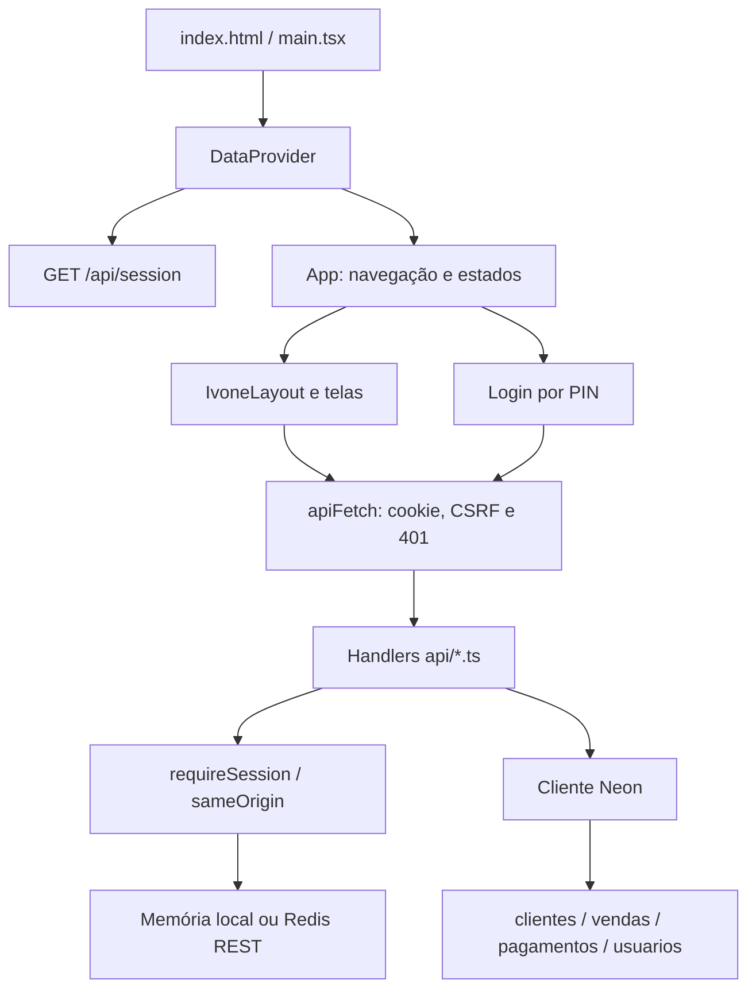
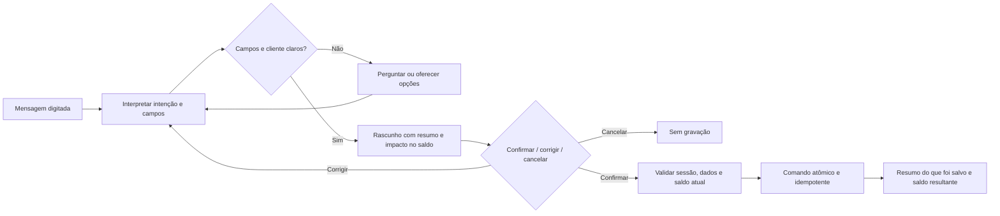

# Análise completa do Ivone-2026 — estado atual da branch dev

**Data:** 11/10/2026, referência de horário America/Sao_Paulo.
**Escopo:** código versionado da `dev` e todos os arquivos locais novos/modificados, inclusive a implementação de segurança ainda não commitada.
**Base Git:** `76a5de999df95517b63e2525564096c9bfe64fc4`. No início da análise, `HEAD`, `main`, `origin/main`, `origin/dev` e `origin/backup-main-2026-10-11` apontavam para essa base. O funcionamento descrito é o da árvore de trabalho local, não uma comprovação do aplicativo publicado.

## 1. Resumo executivo

O aplicativo é um caderno financeiro de uma revendedora: cadastra clientes, registra produtos vendidos, registra recebimentos e calcula a diferença entre vendas e pagamentos de cada cliente. A apresentação mistura os termos venda, pedido e encomenda, mas a persistência contém linhas individuais de venda, sem entidade de pedido ou catálogo de produtos.

Há 11 estados de tela autenticada, uma tela de login, dois usos de modal e um menu de configurações. O celular recebe cartões e quatro atalhos fixos no rodapé; o computador recebe tabelas e mais colunas. Ambos usam a mesma aplicação e as mesmas regras. Não existe interface de chat, interpretação de mensagens, voz, estoque ou gerenciamento de usuários funcionando.

**Os principais riscos antes de evoluir a interface são:**

1. Restauração autenticada aceita arquivo incompleto como conjuntos vazios e pode substituir os registros por nada. Não foi executada restauração para demonstrar esse risco.
2. Sair de uma edição sem salvar e depois escolher uma nova venda ou um novo pagamento reabre a edição anterior. Foi reproduzido com os componentes reais em DOM simulado.
3. Pedidos com vários produtos são salvos por chamadas independentes: falhas intermediárias deixam parte do pedido registrada e uma nova tentativa pode duplicar os itens anteriores.
4. O painel remove centavos dos números exibidos. Também mostra dívida líquida global, que pode ser diferente da soma dos clientes que ainda devem.
5. Datas usam critérios diferentes. O primeiro dia do mês pode ser agrupado no mês anterior em São Paulo, e a data inicial de um formulário pode avançar após 21h.
6. O comportamento de exclusão de clientes precisa ser reconciliado com o banco: a interface promete manter histórico, enquanto o schema histórico do repositório declarou exclusão em cascata. **A existência dessa cascata no Neon atual não foi verificada.**

As alterações locais de segurança corrigem a ausência de proteção das APIs e a confiança na identidade armazenada no navegador. Sessão, logout e CSRF têm testes aprovados. Para produção, porém, o código passa a depender de Redis REST compartilhado; configuração e comportamento reais da Vercel não foram verificados. Comparação direta do PIN e ausência de limitação de tentativas continuam no código.

**Recomendação:** estabilizar segurança, integridade financeira, salvamento e recuperação primeiro; depois compartilhar regras entre as interfaces; por fim acrescentar o chat mobile com rascunho, esclarecimento de ambiguidades e confirmação explícita. A gestão visual do computador pode permanecer como interface complementar sobre o mesmo domínio.

## 2. Método, evidências e limites

### Classificação usada

- **Confirmado por reprodução:** observado em execução isolada usando o código/componentes reais ou a operação exata empregada pelo código.
- **Confirmado no código:** caminho, ausência de validação ou comportamento inequívoco na implementação; não significa que o problema já atingiu registros reais.
- **Suspeita/condicional:** depende de dados, constraints, infraestrutura, navegador ou uso não inspecionado.
- **Melhoria proposta:** comportamento novo ou refatoração; não é apresentado como funcionalidade existente.

Foram inventariados 60 arquivos existentes fora dos arquivos de ambiente. O conjunto inclui fontes, configurações, documentação anterior, testes, lockfile e ativos. Os arquivos de ambiente/credenciais não foram inspecionados. Bibliotecas de terceiros em `node_modules` não são tratadas como código autoral: suas versões e os pontos relevantes de integração foram avaliados. Não há workflow de CI no inventário do repositório.

Nenhuma conexão ao Neon, consulta a registros pessoais, restauração ou migração foi executada. A estrutura de banco foi inferida dos contratos de API, dos tipos e **somente das declarações de tabelas** presentes em `HEAD:api/db.ts`; esse arquivo histórico não representa prova do schema ativo. As declarações de provisionamento foram removidas da árvore local pela tarefa anterior.

Foram realizados testes existentes, verificações TypeScript/build e reproduções adicionais sem persistir novos testes no repositório. A aparência responsiva foi analisada pelo JSX/CSS; não houve inspeção visual em navegador real ou aparelho físico. DOM simulado não calcula o layout real nem aplica políticas de cookies como um navegador.

## 3. Arquitetura e ciclo de execução

### Frontend

- `index.html`: idioma pt-BR, viewport com safe area, título, favicon embutido e carregamento da fonte Poppins.
- `src/main.tsx`: monta React com `StrictMode`, `DataProvider`, `App` e CSS global.
- `src/App.tsx`: escolhe a tela por `activeView`, mantém pilha de voltar, cliente pré-selecionado, venda/pagamento em edição e toast. Não usa roteador de URLs.
- `src/contexto/DataContext.tsx`: identidade, carregamento de dados, listas em memória, operações CRUD e saldos derivados. Mistura responsabilidades de autenticação, comunicação e negócio.
- `src/lib/api.ts`: cliente HTTP compartilhado, token CSRF somente em memória, cookies de mesma origem, cache desabilitado e descarte de respostas de sessão anterior.

No início, o contexto consulta a sessão. Com identidade confirmada, busca clientes, vendas e pagamentos em paralelo. Durante `isLoading`, `App` retorna apenas um spinner; as telas anteriores são desmontadas. Sem identidade, retorna a tela de PIN. Com identidade, monta layout e tela selecionada.

Os dados de negócio não são salvos em `localStorage`; persistem no banco via APIs e ficam em memória na aba. Apenas a preferência de tema usa armazenamento local. O antigo `ivone_user` é removido. Não há service worker, fila offline, cache de negócio durável ou sincronização em tempo real.

### Backend local

`server.ts` inicia Express na porta 3000, exposto em `0.0.0.0`, com JSON e logs de método/caminho. Em desenvolvimento integra Vite por middleware. Registra os mesmos handlers utilizados pela Vercel e os envolve com captura de exceções. Não existe mais criação de tabelas/usuário na inicialização local.

Há rotas com e sem `/:id`, mas os handlers usam `req.query.id`. O frontend usa `?id=...`, que é o formato efetivamente suportado para alterações. O ramo de produção local serve `dist` e registra `app.get('*', ...)`; essa sintaxe falha com Express 5 instalado, conforme reprodução isolada e documentação oficial. Não foi iniciado o servidor real em produção.

### Backend Vercel

Cada arquivo público de `api/` é uma função de entrada. A verificação de sessão ocorre dentro dos handlers de negócio; não depende exclusivamente do middleware Express. `vercel.json` mantém `/api/*` e direciona os demais caminhos para `index.html`.

O helper de sessão fica em `server/lib/`, fora da pasta de funções públicas. O build Vite gera o frontend; não produz sozinho um servidor Express compilado. A compilação/execução de funções na Vercel depende do ambiente da plataforma, não verificado nesta tarefa.

## 4. Navegação e inventário completo das telas

Os identificadores abaixo são os 11 valores de `View` em `src/types.ts`. A tela de login é uma condição anterior, não um desses valores.

| Tela/estado | Entradas e informações | Controles e destino | Observações |
|---|---|---|---|
| Login | Logo, saudação, PIN oculto, erro e carregamento | Digitar até quatro números; Acessar Caderninho | Usuário enviado pelo frontend é fixo como identificador público; não há seleção de conta nem recuperação de PIN. Botão desabilitado enquanto envia. |
| `dashboard` | Ações rápidas e quatro indicadores | Nova Venda; Receber Pagamento; Novo Cliente; Gerenciar Clientes; Relatórios; Histórico Geral; indicadores clicáveis | Indicadores: clientes, valor de encomendas, recebidos e falta pagar; todos consideram o conjunto inteiro carregado, sem período. |
| `clients` | Clientes e estado financeiro | Busca; Adicionar Cliente; clicar cliente; excluir; Cadastrar Primeiro Cliente no vazio | Busca nome, telefone, e-mail e campos de endereço/CEP; não CPF nem observação. Desktop tabela, mobile cartões. |
| `add_client` | Formulário de cadastro | Cadastrar Cliente; voltar pelo layout | Após sucesso navega para clientes; não há revisão separada nem mensagem de sucesso explícita do formulário. |
| `client_detail` | Nome, telefone, endereço quando há rua e saldo; extrato | Nova Venda; Registrar Pagamento; Editar Cliente | CPF, e-mail, complemento e observação não são apresentados no resumo do detalhe. Edição de cliente abre modal. |
| `add_sale` | Cliente, data, linhas de produtos, observação e total | Selecionar/buscar cliente; adicionar/remover produto; salvar/atualizar | Nova venda pode ter várias linhas; edição permite uma linha. Sucesso leva ao início e gera toast. |
| `sales_view` | Lista de clientes e situação da dívida | Busca nome/telefone/e-mail; clicar cliente; voltar para clientes na subvisão; editar/excluir venda | Subvisão lista vendas por mês, mais recentes primeiro, coloridas por quitação FIFO. Não é uma lista global de todos os pedidos. |
| `add_payment` | Cliente, data, valor, observação e dívida | Selecionar cliente; Confirmar Recebimento/Atualizar Recebimento | Seleção do cliente desabilitada na edição. Não há botão para preencher automaticamente a dívida inteira. |
| `all_payments` | Clientes com soma de pagamentos positiva e seus totais | Clicar cliente; voltar à lista; editar/excluir recebimento | Sem busca. Subvisão mostra recebimentos, observações, datas e valores. Não significa que o cliente quitou todas as compras. |
| `pending_payments` | Clientes cujo saldo é positivo | Clicar cliente abre detalhe | Ordena maior dívida primeiro. Não usa vencimento nem sinaliza atraso por dias. |
| `reports` | Top 5 clientes por valor vendido e Top 5 produtos por quantidade | Consulta visual | Sem filtro, gráfico, exportação ou interação nos itens. Produtos agregados pelo texto exato do nome. |
| `history` | Linha do tempo geral de vendas/pagamentos por dia | Filtrar por data; modal de calendário; mês anterior/próximo; selecionar dia; Limpar Filtro | Somente consulta. Não é auditoria de edições/exclusões e não informa quem alterou um registro. |

### Elementos persistentes do layout

- Cabeçalho com logo e saudação, cujo texto não muda conforme o usuário da sessão.
- No início: engrenagem de configurações e botão de sair; fora do início: botão voltar.
- Indicadores somente no início. Em mobile, aparecem em grade 2 × 2; em telas grandes podem formar linha flexível.
- Rodapé mobile com **Início, Clientes, Encomendas, Pagos**, acionando navegação interna. Pendências, relatórios e histórico são alcançados pelo início.
- Botão extra de sair possui `hidden`, `md:flex` e `md:hidden` simultaneamente: fica oculto no mobile e também no breakpoint desktop; é código de controle redundante/inconsistente.
- Toast com mensagem, ícone e fechar; duração pretendida de três segundos. `App` e `Toast` mantêm temporizadores independentes.

### Configurações e modais

| Elemento | Funcionamento atual |
|---|---|
| Menu Configurações | Engrenagem alterna abrir/fechar; X fecha. Disponível no início. Sem fechar automaticamente por clique externo ou Escape. |
| Tema Escuro | Alterna classe `dark` no HTML e `ivone_theme`; usa preferência do sistema se não há valor salvo. CSS escuro é parcial. |
| Realizar Backup | GET protegido; transforma JSON em Blob; baixa `backup_ivone_<data UTC>.json` e revoga a URL local. Não contém `usuarios`. |
| Subir Backup | Input de arquivo JSON oculto; confirmação nativa antes da leitura; envia POST protegido; sucesso solicita atualização de dados. Erros de rede/autorização também podem aparecer como “Arquivo inválido”. |
| Modal Editar Cliente | Reusa `ClientForm`; atualiza dados e fecha no sucesso. |
| Modal Calendário | Mostra dias com movimentos, mês anterior/próximo, seleção de dia e X para fechar. |

### Persistência da navegação

Não há URL diferente por tela, deep link, integração com o botão voltar do navegador nem restauração da tela após reload. A pilha guarda **somente o identificador da tela**, não seleção interna de cliente, filtro ou rascunho. Ao voltar para Encomendas/Pagos, a subvisão pode reiniciar na lista. Salvar um formulário adiciona o destino à pilha normal, permitindo voltar à tela anterior do formulário.

`selectedClientId`, `editingSale` e `editingPayment` persistem em `App`. O cliente é alterado apenas quando um ID é fornecido; não é limpo ao escolher uma ação genérica no início. As edições são limpas no sucesso, não no cancelamento/voltar, logout ou troca de tela. Essas regras explicam os problemas reproduzidos de reabertura de edição e cliente antigo pré-selecionado.

## 5. Formulários e fluxos completos

### 5.1 Clientes

**Campos:** nome completo; CEP; rua; número; complemento; bairro; cidade; UF; telefone; e-mail; CPF; observação.

- Nome convertido para minúsculas e depois inicial maiúscula a cada palavra separada por espaço; não há trim ou tratamento de nomes duplicados.
- Telefone: remove não dígitos, limita 11 números e aplica máscara de fixo/celular. Não valida existência nem tamanho obrigatório.
- CEP: máscara 5–3, máximo nove caracteres; ao sair do campo, exige oito dígitos para consultar ViaCEP.
- ViaCEP é acessado diretamente pelo navegador. Sucesso preenche rua, bairro, cidade, UF e complemento e foca número. CEP não encontrado limpa parte do endereço. Falha informa erro e permite continuar manualmente.
- E-mail usa validação nativa por `type=email` e atalhos Gmail/Hotmail/Yahoo; o atalho substitui o domínio mantendo a parte anterior a `@`.
- UF limitada a dois caracteres; CPF não recebe máscara nem cálculo de dígitos verificadores.
- Nome não tem `required`. Campos vazios, inclusive nome, não são barrados pelo formulário; APIs também não validam esse conteúdo.

**Criar:** formulário → `addClient` → POST → registro retornado → acrescenta à lista local → navega para clientes.
**Editar:** detalhe → modal → `updateClient` → PUT com todos os campos → substitui item local → fecha modal.
**Excluir:** confirmação nativa → DELETE → remove somente o cliente da lista local. Vendas/pagamentos não são removidos/recarregados nesse momento.

A confirmação afirma que transações continuarão no histórico. Isso precisa ser resolvido com o comportamento real da FK antes de qualquer mudança: schema histórico declarou cascata; schema atual desconhecido. Não há arquivamento/soft delete ou desfazer no aplicativo.

### 5.2 Vendas, pedidos e encomendas

**Por linha:** código opcional, descrição obrigatória, quantidade, preço unitário. Cliente, data e observação são comuns a todas as linhas.

- Seleção customizada de cliente: botão abre dropdown, busca por nome, lista alfabética, selecionar fecha; clique externo por `mousedown` fecha.
- Não há opção de cadastrar cliente dentro desse dropdown.
- Nova linha começa em quantidade 1/preço 0; adicionar várias linhas é permitido. Remover linha só aparece com mais de uma; a última não pode ser removida.
- Quantidade: input numérico com mínimo 1 e passo nativo padrão inteiro. Preço: mínimo 0, passo 0,01. Produto marcado obrigatório; data não é obrigatória no HTML.
- Preço zero é aceito. Código não referencia catálogo. Observação livre é replicada nas linhas.
- Data inicial usa ISO UTC do instante atual, não data civil de São Paulo.
- O total visual soma produtos dos números convertidos por `parseFloat`; o contexto arredonda cada linha para duas casas antes de enviar.

**Criar várias linhas:** `SaleForm` chama `addSale` uma vez por linha, sequencialmente. Cada chamada envia um POST e acrescenta o retorno à lista local. Não existe transação abrangendo o pedido, identificador de pedido ou rollback dos itens anteriores. Quantidade não positiva é ignorada no caminho de criação quando o handler chega a recebê-la; as regras nativas do formulário normalmente barram esse valor na interação comum.

**Editar:** usa somente `items[0]`, recalcula total no contexto e faz PUT. É possível mudar o cliente de uma venda. Não há nova confirmação nem informação sobre impacto na dívida das duas pessoas.

**Excluir:** confirmação nativa, DELETE, retirada da venda da lista local e toast. Saldo e quitação derivada mudam imediatamente. Não existe estorno registrado como nova transação/auditoria.

**Falha ou resposta perdida:** itens já aceitos continuam persistidos; formulário pode conservar todas as linhas. Não há chave de idempotência, reconciliação ou operação “salvar pedido completo”. Reenviar pode duplicar vendas. Esse é um risco estrutural confirmado no código; não foi executada gravação no banco.

### 5.3 Pagamentos totais, parciais e créditos

- Um pagamento pertence a um cliente, sem ligação explícita a uma venda.
- Usuária escolhe cliente, informa data, valor e observação; botão desabilitado sem cliente ou durante envio.
- Valor precisa ser maior que zero no frontend; input tem mínimo 0,01/passo 0,01. Essa regra não é validada pelo backend.
- Dívida do cliente é mostrada, mas não copiada automaticamente para o valor. Para quitar, a usuária precisa digitar o total.
- Pagamento abaixo da dívida reduz o saldo e representa quitação parcial agregada; igual zera; acima da dívida gera saldo negativo/crédito. Não há teto no valor nem aviso de excesso.
- Na edição, o valor antigo é somado de volta à dívida apresentada para mostrar a dívida antes desse recebimento. O cliente fica bloqueado no formulário, mas a API aceita alteração de `clientId`.
- Sucesso cria/atualiza a lista local, volta ao início e mostra toast. Falha usa `alert` genérico.
- Exclusão remove registro e eleva a dívida. Não existe registro compensatório nem desfazer.

Não existem campo estruturado de forma de pagamento, parcela, vencimento, comprovante, juros, desconto, comissão, custo, lucro ou conciliação. Pix/dinheiro podem aparecer apenas como observação.

### 5.4 Extrato, histórico e relatórios

O extrato do detalhe junta vendas e recebimentos do cliente, ordena por data decrescente e agrupa por mês. Mostra compra com sinal negativo e pagamento com positivo, enquanto o saldo devedor usa a convenção inversa: compras aumentam dívida. Não apresenta saldo acumulado por movimento, saldo inicial/final por período nem filtro no extrato.

O histórico global junta as duas listas, agrupa por data e permite selecionar um dia. “Hoje” e “Ontem” são rótulos calculados no navegador. Exibe produto/quantidade, cliente e valor; não lista cadastros, modificações, exclusões ou restaurações. Datas iguais não têm ordem determinística por horário/ID.

Relatórios usam todo o período: clientes ordenados por soma de vendas, primeiros cinco; produtos pelo nome exato e quantidade, primeiros cinco. Variações de grafia/espaços/caixa viram produtos distintos. O total monetário por produto é calculado, mas a tela mostra apenas unidades. Não são relatórios de lucro, caixa por período ou inadimplência por vencimento.

## 6. Regras financeiras, cálculos e exemplos

| Regra | Expressão/critério atual | Origem |
|---|---|---|
| Total da linha | `parseFloat((quantity * unitPrice).toFixed(2))` no contexto | `DataContext` |
| Total visual do pedido | Soma `quantity * unitPrice` de todas as linhas; formatação BRL | `SaleForm` |
| Saldo devedor do cliente | Soma de vendas menos soma de pagamentos, todos os períodos | `DataContext.clientBalances` |
| Cliente pendente | Saldo estritamente maior que zero | `PendingPayments` |
| Cliente em dia | Saldo menor ou igual a zero | Gestão e Encomendas; crédito não é distinguido |
| Total recebido por cliente | Soma dos pagamentos; só aparece em Pagos se maior que zero | `AllPayments` |
| “Falta Pagar” geral | Soma global de vendas menos pagamentos | `HeaderSummary` |
| Venda quitada/parcial/aberta | Pagamentos totais consumidos em vendas da mais antiga à mais nova | Detalhe e Encomendas |
| Top cliente | Soma dos totais de venda | `Reports` |
| Top produto | Soma da quantidade por nome textual exato | `Reports` |

**Exemplos fictícios:**

- Compra de R$ 100,00 + recebimento R$ 30,00 → dívida R$ 70,00. Recebimento adicional R$ 70,00 → zero. Mais R$ 20,00 → crédito R$ 20,00, atualmente apresentado como saldo devedor negativo/“Em dia”.
- Cliente A deve R$ 100,00; cliente B tem crédito R$ 40,00 → painel mostra R$ 60,00 de “Falta Pagar”, mas a lista de devedores soma R$ 100,00. As duas fórmulas são diferentes; antes de corrigir, distinguir dívida a receber, créditos e posição líquida.
- Valor R$ 123,45 → o contador animado termina em R$ 123,00 porque usa `Math.floor`, também no fim da animação. Isso não altera o banco, mas altera o valor comunicado.
- Vendas R$ 100,00 e R$ 80,00; pagamentos somam R$ 120,00 → primeira verde/quitada, segunda amarela/parcial. Não fica persistido que R$ 20,00 foram destinados à segunda.

### Quitação FIFO é derivada, não vínculo financeiro persistido

O algoritmo usa **todos** os pagamentos do cliente, inclusive posteriores/futuros em relação às compras analisadas, para quitar as vendas mais antigas. Não considera vencimento nem data efetiva da aplicação do recebimento. Não permite escolher “este pagamento é desta venda”. Editar/excluir uma venda ou pagamento redistribui a classificação das demais. Empates por data dependem da ordem carregada, sem critério por ID/horário.

Esse mesmo algoritmo aparece em dois componentes. A duplicação e a ausência de desempate são confirmadas; uma regra diferente de baixa por venda precisa ser uma decisão de produto, não uma suposição na nova interface.

### Precisão e fonte da verdade

Dinheiro é representado como `number`/ponto flutuante no frontend. `parseFloat` converte valores decimais do banco. Somatórios e comparação `balance > 0` não têm arredondamento consistente por centavos. Isso permite resíduos numéricos em determinadas combinações; a ocorrência com dados reais não foi investigada.

O servidor aceita `total` enviado pelo cliente sem conferir multiplicação, sinal ou precisão. SQL parametrizado protege os valores contra injeção SQL nesses handlers, mas não valida regras financeiras. A interface não deve ser a única autoridade do total no futuro.

## 7. Persistência e estrutura do Neon: o que é conhecido

### Contrato observado no código

| Tabela | Campos lidos/escritos pelos handlers | Relação de negócio |
|---|---|---|
| `clientes` | `id`, `full_name`, telefone, e-mail, endereço completo, CPF e observação | Cadastro referenciado por vendas/pagamentos |
| `vendas` | `id`, `client_id`, `sale_date`, `product_code`, `product_name`, `quantity`, `unit_price`, `total`, `observation` | Muitas linhas para um cliente |
| `pagamentos` | `id`, `client_id`, `payment_date`, `amount`, `observation` | Muitos recebimentos para um cliente |
| `usuarios` | Login consulta `id`, `username`, `pin`; campo histórico `nome` | Autenticação; nenhum vínculo com propriedade dos registros |

Frontend usa camelCase; handlers convertem campos snake_case do banco. Observações/contatos vazios ou nulos são normalizados para strings vazias nas respostas. Valores monetários são convertidos por `parseFloat`. Datas de vendas/pagamentos são tratadas como objetos `Date` e convertidas para `YYYY-MM-DD`.

### Schema declarado na base Git, não inspecionado no banco

- IDs UUID com chave primária e default `gen_random_uuid()` nas quatro tabelas.
- `clientes.full_name` TEXT NOT NULL; contatos/endereço/CPF/observação TEXT opcionais. NOT NULL não impede string vazia.
- `vendas.client_id` UUID referenciando clientes, com **ON DELETE CASCADE**; `sale_date` DATE com default do dia; `quantity` INTEGER com default 1; preço e total DECIMAL(10,2) NOT NULL; produto TEXT NOT NULL.
- `pagamentos.client_id` também com **ON DELETE CASCADE**; data DATE com default do dia e valor DECIMAL(10,2) NOT NULL.
- `usuarios.username` único; `pin` TEXT NOT NULL; `nome` opcional na declaração histórica.
- As declarações históricas não tornavam `client_id`/datas obrigatórios nem continham CHECK de valores positivos.

Não se verificaram schemas, índices, constraints, roles, permissões, triggers, RLS, extensões, registros órfãos, duplicatas ou quantidade de dados reais. Sem migrations/DDL atual no projeto, não é possível afirmar que produção corresponde às declarações antigas. A ausência de consultas ao Neon é deliberada.

### Cliente de banco e transações

`api/db.ts` mantém a resolução das variáveis de conexão, a remoção de `-pooler`, a adição de `schema=public`, configuração WebSocket e pool preguiçoso. Nenhum valor foi consultado/exposto nesta análise. Esses ajustes de conexão precisam ser avaliados em staging, pois não foram testados contra serviço real.

CRUD comum faz uma instrução por chamada. Não há versionamento otimista, auditoria, idempotência ou transação do pedido de múltiplos produtos. A única transação explícita de negócio é a restauração. Não há sincronização automática entre abas/dispositivos.

## 8. APIs: contratos e proteção

| Endpoint | Métodos | Entrada e saída | Persistência |
|---|---|---|---|
| `/api/login` | POST | JSON usuário/PIN; retorna sucesso, identidade e CSRF; cookie de sessão | SELECT de usuário; cria sessão fora do Neon |
| `/api/session` | GET | Identidade e CSRF da sessão; 401 quando inválida | Store de sessão |
| `/api/logout` | POST | Exige sessão/origem/CSRF; sucesso após revogar cookie/store | Remove sessão, não usuário |
| `/api/clients` | GET/POST/PUT/DELETE | GET lista completa; POST objeto; PUT/DELETE `?id=` | Cadastro de clientes |
| `/api/sales` | GET/POST/PUT/DELETE | Lista completa; objeto de linha; PUT/DELETE `?id=` | Vendas individuais |
| `/api/payments` | GET/POST/PUT/DELETE | Lista completa; objeto de recebimento; PUT/DELETE `?id=` | Pagamentos individuais |
| `/api/backup` | GET/POST | Exportação ou substituição por JSON bruto/envelopado | Clientes, vendas e pagamentos |

Nos CRUDs, GET não filtra por `id`; não há paginação ou agregações no servidor. `PUT` substitui todos os campos relevantes, sem PATCH. IDs são apenas checados por existência do parâmetro, não formato UUID ou array. Atualizações ausentes retornam 404; exclusões retornam sucesso mesmo quando nenhuma linha foi afetada. Métodos não suportados retornam 405.

Os handlers têm validação de sessão antes de acesso a dados. GETs recebem `no-store`; métodos de escrita também precisam de CSRF e origem correspondente. APIs não recebem no corpo um usuário autorizado para substituir a sessão. SQL usa parâmetros para valores. Não há roles, ownership por usuário nem permissão específica de restauração: uma sessão válida tem o conjunto inteiro de poderes do aplicativo.

Respostas públicas de erro foram simplificadas nas alterações locais e não incluem mensagem interna do banco. Falhas de sessão podem resultar em 503, origem/CSRF em 403 e sessão inválida em 401. O cliente HTTP procura `message`; alguns CRUDs retornam somente `error`, levando a mensagem genérica na interface.

## 9. Backup, restauração e recuperação

### Exportação atual

Formato: versão `1.0`, timestamp UTC, `data.clients`, `data.sales`, `data.payments`. Os dados são linhas brutas do banco em snake_case. Usuários, PINs e sessões não são parte dessa exportação de aplicativo. Não há SQL de recuperação, contagens verificadas, checksum, validação de FK ou indicação de quais dados foram omitidos.

As três consultas GET são independentes/paralelas, sem snapshot transacional comum. Uma gravação concorrente pode produzir conjuntos que não representam exatamente o mesmo instante. O timestamp do envelope não resolve isso. As consultas `SELECT *` também não mantêm whitelist de colunas se o schema futuramente ganhar novos campos.

### Restauração existente

Lê `body.data || body`. Campos de listas ausentes viram `[]`. Abre transação, apaga pagamentos/vendas/clientes e reinsere clientes primeiro, depois vendas/pagamentos; tenta preservar os IDs fornecidos. Na falha dentro da transação, executa rollback. Não altera usuários.

**O problema central:** arquivo `{}` tem listas vazias por default e não gera erro por falta de dados. Com sessão e CSRF válidos, o caminho pode limpar as três tabelas e confirmar a transação sem reinserção. Não há prévia de quantidades, confirmação no servidor, validação de versão, formato, duplicatas, vínculos ou valores antes da exclusão. A confirmação do navegador expressa intenção, mas não valida conteúdo.

Outros pontos: conexão é obtida fora do `try` interno; default `quantity || 1` muda quantidade zero; `total || multiplicação` muda total zero; defaults escondem ausência de campos. Arquivos grandes não têm limite próprio ou tratamento da duração por função. Express usa limite padrão do parser JSON. Não há cópia anterior automática nem proteção contra alteração concorrente durante a restauração.

Nenhum desses caminhos destrutivos foi executado. A transação é um mecanismo útil a preservar, mas não torna seguro restaurar entrada não validada.

## 10. Autenticação e impacto das mudanças locais de segurança

### Fluxo atual da árvore local

1. Navegador consulta `/api/session`; identidade em `localStorage` é descartada.
2. Login aceita JSON de mesma origem e PIN com exatamente quatro números; consulta somente os campos necessários. Erro público não distingue usuário ausente de PIN incorreto.
3. Servidor cria token aleatório de 256 bits. O cookie contém o token opaco; chave no store usa SHA-256 do token. Guarda identidade mínima, CSRF e expiração, sem PIN.
4. Cookie: `HttpOnly`, `SameSite=Strict`, caminho raiz e oito horas absolutas. Produção/Vercel adiciona `Secure` e prefixo `__Host-`; não há Domain.
5. Redis REST guarda sessões com TTL em produção. Memória é permitida somente em development/test local, nunca Vercel. Reiniciar desenvolvimento encerra sessões.
6. Escritas exigem origem correspondente e token CSRF de sessão. Login exige origem/JSON; consulta de sessão recupera CSRF após reload. `Sec-Fetch-Site`, se presente, precisa ser same-origin nas verificações de origem.
7. Logout revoga no store antes de limpar cookie. Falha retorna 503 e não é anunciada como sucesso. 401 limpa identidade/listas do frontend; respostas tardias de outra geração são descartadas.

### O que foi corrigido pela implementação anterior

APIs não dependem mais de um bloqueio visual do frontend. Cliente/pagamento/venda/backup estão protegidos em seus próprios handlers. Logout tem efeito no servidor. PIN/erros/conexão não são registrados nos logs anteriores. Inicialização automática e credencial padrão foram retiradas do código local. Definições Vite que poderiam copiar chaves para o frontend foram removidas. Nenhuma migração ou transformação dos PINs existentes foi feita.

### Impactos operacionais e limitações

- **Dependência nova de produção:** `AUTH_REDIS_REST_URL` e `AUTH_REDIS_REST_TOKEN`. O código falha fechado se inexistentes/inválidos; não se inspecionou se estão disponíveis na infraestrutura. `AUTH_APP_ORIGIN` é opcional e deve corresponder à origem usada em arranjos com proxy/domínio específico.
- **Disponibilidade:** falha no store bloqueia validação de sessão mesmo com Neon disponível. Não há retry automático documentado para o store; chamadas têm timeout de cinco segundos.
- **Experiência:** oito horas de sessão não significam login permanente. 401 desmonta a tela e pode perder rascunho sem mecanismo de recuperação. 403 não renova CSRF automaticamente. 503 de bootstrap leva ao login sem explicar separadamente o serviço de sessão.
- **Abas:** token CSRF fica em memória de cada aba. Um novo login que substitua o cookie de outra aba pode deixar nessa aba um token antigo, resultando em 403 até recarga. Não há broadcast de sessão nem refresh em foco.
- **Credenciais e permissões:** PIN continua sendo comparado diretamente, sem hash no código; não há throttling. Uma sessão existente não reconsulta o usuário para detectar exclusão/troca de PIN, e não há revogação global por usuário. Nenhuma evidência de valores reais foi coletada.
- **Compatibilidade:** consumidores externos antigos precisam passar pela sessão/origem/CSRF. Não há CORS liberado para frontends em outra origem. Isso é proteção intencional, mas exige validar arquitetura de staging/produção.
- **Garantia de lançamento:** alterações continuam locais; não se presume que o site publicado as utilize. Sem staging e configuração compartilhada real, não são consideradas prontas para deploy apenas pelos testes simulados.

As recomendações de sessão e limitação de login se apoiam nas orientações da [OWASP sobre sessões](https://cheatsheetseries.owasp.org/cheatsheets/Session_Management_Cheat_Sheet.html) e [autenticação](https://cheatsheetseries.owasp.org/cheatsheets/Authentication_Cheat_Sheet.html).

## 11. Responsividade, apresentação e acessibilidade

### Celular

CSS usa `md` para alternar tabelas/cartões, aproximadamente 768 px no tema padrão; `lg` para informações adicionais/relatórios, aproximadamente 1024 px. `useIsMobile` declara 768 px, mas não é consumido. Layout usa padding de safe area e rodapé fixo com safe-area-inset-bottom.

Formulários ficam predominantemente em uma coluna, com quantidade/preço lado a lado. Total individual por linha de venda é escondido no mobile; total geral permanece. Cliente/pendências/encomendas/pagos usam cartões tocáveis; extratos/listas têm scroll interno limitado por viewport. Texto secundário chega a 9–10 px. Não há interface por mensagens ou entrada persistente de chat.

### Computador

Tabelas em gestão, seleção de encomendas, recebimentos e pendências; e-mail de clientes aparece apenas em `lg`. Formulários ganham duas/três colunas, cards maiores e total por linha. Relatórios ficam em duas colunas em `lg`. Não há menu lateral ou conjunto de abas desktop fixo: navegação depende do início/voltar.

### Tema e problemas visuais que exigem cuidado

Identidade visual de caderno: rosa, verdes de recebimentos, amarelo de parcial, cards arredondados, textura de papel, espiral no login e animações. O CSS global escolhe Inter, mas HTML carrega Poppins adicionalmente. Há dependência externa de Google Fonts.

Tema escuro altera body, textura, títulos e `.bg-white`, mas muitos fundos claros e textos explícitos permanecem. Está incompleto no código; contraste e colisões visuais são suspeitas a testar. Classes customizadas como `animate-view-enter`, `animate-slide-in` e `modal-backdrop` são usadas e não aparecem no CSS gerado analisado; não produzem os efeitos sugeridos pelos nomes.

Confirmações/erros usam `confirm`/`alert` nativos, que mudam de apresentação conforme plataforma. Status da venda é comunicado predominantemente por cor, sem legenda/texto de pago/parcial/aberto no card. Há `div`, linha de tabela e `li` clicáveis sem comportamento equivalente de teclado; vários inputs de venda/pagamento não têm `id` ligado ao label. Modais não implementam focus trap, Escape ou semântica completa de diálogo. Esses aspectos são confirmados no markup; qualidade final de navegação assistiva não foi testada.

Sobreposição do cabeçalho em 320–360 px, teclado virtual cobrindo controles, scroll interno, toque externo de dropdown, safe area e contraste devem ser testados em dispositivos reais. Não são relatados como defeitos observados visualmente nesta tarefa.

## 12. Inventário de componentes, código auxiliar e duplicações

| Arquivo/grupo | Responsabilidade e estado |
|---|---|
| `src/types.ts` | Contratos de Client/Sale/Payment e 11 telas reais. Campos do frontend tratados como completos. |
| `src/components/common.tsx` | Card, Button, Input, TextArea, Select e Modal efetivamente usados por imports `../common`. |
| `src/components/common/` + `index.ts` | Segunda implementação dos mesmos seis componentes. O import explícito do Modal em App é não utilizado; não torna esse conjunto o padrão das telas. |
| `src/components/ui/Icons.tsx` | SVGs inline usados pela interface; contém ícones sem funcionalidade ligada, inclusive chat/usuários/estoque simbólico. SaleForm usa Lucide adicionalmente. |
| `src/components/ui/Toast.tsx` | Mensagem fechável e timer próprio. |
| `src/components/ui/EmptyState.tsx` | Ícone, título, mensagem e ação opcional para listas vazias. |
| `src/components/ui/index.ts` | Reexporta os componentes visuais auxiliares. |
| `src/hooks/useLocalStorage.ts` | Hook genérico com listener de outras abas; não é utilizado. Não é o mecanismo atual de sessão. |
| `src/hooks/useIsMobile.ts` | Detecta tamanho da janela; não é utilizado. |
| `src/index.css` | Tema, classes de caderno/menu, estilos escuros parciais e animações próprias. |
| `public/logo-ivone.png` / `.gitkeep` | Logo usada em login/layout e marcador de pasta. |
| `app/applet/temp_repo/dummy.txt` | Resíduo sem importação ou função de negócio. |
| `docs/authentication.md` | Documentação anterior das alterações locais de segurança e pendências. |

A resolução TypeScript foi consultada e confirmou que `../common` em ClientForm aponta para `src/components/common.tsx`, não para `common/index.ts`. As duas famílias têm estilos e recursos diferentes; consolidar sem verificar resolução poderia mudar a aparência.

Outras duplicações/resíduos: FIFO em detalhe/encomendas; conversão de linhas de clientes repetida em GET/POST/PUT; formatação monetária/datas espalhada; listas desktop/mobile duplicadas no JSX; tipo local `View` em ClientDetail inclui `stock`, `manage_users`, `user_summary` inexistentes no App; imports/variáveis sem uso como `firstSaleId`, `contextLoading`, Modal de App e diversos ícones. TypeScript atual não exige ausência de imports/variáveis sem uso nem modo strict.

## 13. Dependências e configurações

| Grupo | Versões resolvidas relevantes no lockfile | Uso/observação |
|---|---|---|
| Interface | React/ReactDOM 19.2.5, Motion 12.38.0, Lucide 0.546.0 | Componentes, animações, ícones |
| Estilos/build | Vite 6.4.2, plugin React 5.2.0, Tailwind/plugin 4.2.2, TypeScript 5.8.3 | Build e verificação |
| HTTP local | Express 5.2.1 | Mesmos handlers, integrado a Vite |
| Banco | Neon serverless 1.1.0, ws 8.20.0 | Pool/WebSocket; `pg` 8.20.0 declarado, sem import direto de aplicação |
| Ambiente | dotenv 17.4.2 | Configuração de servidor; default lê `.env` |
| Testes | tsx 4.21.0, jsdom 29.1.1, node:test | Execução TypeScript e DOM simulado |
| Plataforma/tipos | `@vercel/node` e tipos de Node/React/Express/pg/ws | Funções e compilação |
| Declarados sem uso direto atual | cors, pg, autoprefixer; tipos correspondentes | Avaliar remoção separadamente, não feita aqui |

Lockfile v3 com 468 entradas de pacote; isso não é contagem de bibliotecas próprias nem garantia contra vulnerabilidades. Não foi feita auditoria de CVEs nem atualização de dependências nesta tarefa.

Scripts: `dev` inicia `tsx server.ts`; `build` gera `dist`; `preview` é somente Vite preview e não monta as APIs locais; `lint` é TypeScript sem emitir, não um linter de estilo; `test` executa duas suites. Sem script `start`, configuração de runtime/engines ou CI documentada no projeto.

Node utilizado nas verificações: 24.14.1. Plugin React/jsdom exigem versões modernas específicas; os testes usam `node:module.registerHooks`, tornando insuficiente assumir que qualquer Node listado genericamente no README executa as suites. Runtime real da Vercel não foi consultado.

README é o template de AI Studio, manda configurar chave de Gemini em `.env.local`, mas não há implementação de Gemini no código e `dotenv.config()` do servidor não seleciona `.env.local`. `metadata.json` pede permissão de microfone, porém não há implementação de captação/voz. `.gitignore` protege dependências, builds, logs e arquivos `.env`, exceto template; não tem regra específica `backups/`. Nenhum backup foi criado nesta análise.

## 14. Problemas confirmados — evidência, efeito e prioridade

**P0:** risco grave de perda/integridade; **P1:** corrigir antes de evoluir/publicar; **P2:** estabilização e usabilidade; **P3:** manutenção. Prioridades são propostas, não mudanças autorizadas.

| ID | Prioridade | Problema e efeito | Evidência/localização | Tipo de confirmação |
|---|---|---|---|---|
| C01 | P0 | Restauração de arquivo sem listas aceita defaults vazios e pode apagar todo o conjunto de negócio | `api/backup.ts:31–41`, COMMIT sem validação prévia | Código; execução destrutiva não realizada |
| C02 | P0 | Pedido multi-item não atômico/idempotente: salva parcialmente; retry pode duplicar | `SaleForm.tsx:127–147`, chamadas sequenciais `addSale` | Código |
| C03 | P0 | Abandonar edição faz “Nova Venda” editar venda antiga | `App.tsx:35,69–73,115–122`; estado não limpo ao voltar | Componentes reais em DOM simulado |
| C04 | P0 | Abandonar edição faz “Receber Pagamento” atualizar recebimento antigo | `App.tsx:36,75–78,125–133` | Componentes reais em DOM simulado |
| C05 | P1 | Cliente anterior continua pré-selecionado em ação genérica; risco de associação errada | `App.tsx:60–62,117,128` | Componentes reais em DOM simulado |
| C06 | P1 | Servidor aceita totais/valores/quantidades sem regra financeira | `api/sales.ts`, `api/payments.ts`; total enviado pelo browser | Código |
| C07 | P1 | Contador de moeda elimina centavos e floor piora negativos | `HeaderSummary.tsx:21` | Reprodução da operação; 123,45 → 123 |
| C08 | P1 | Indicador “Falta Pagar” desconta crédito de outro cliente e difere da lista de dívidas | `HeaderSummary.tsx:43` versus `PendingPayments` | Reprodução aritmética |
| C09 | P1 | Data inicial de venda/pagamento é UTC e pode virar amanhã após 21h em São Paulo | `SaleForm.tsx:29,59`; `PaymentForm.tsx:18` | Reprodução com instante fictício |
| C10 | P1 | Agrupamento mensal do extrato interpreta data civil como UTC, podendo deslocar mês | `ClientDetail.tsx:15` | 01/10 → 30/09 em São Paulo |
| C11 | P1 | Produção Express usa wildcard incompatível com Express 5 e falha ao registrar rota | `server.ts:70` | Registro isolado da rota; não servidor real |
| C12 | P1 | Exclusão local de cliente não atualiza vendas/pagamentos e promete manter histórico | `DataContext.tsx:159–162`, mensagem em ManageClients | Omissão/promessa confirmadas; cascata real é S01 |
| C13 | P1 | Backup não é snapshot consistente nem valida quantidade/FKs; não é recuperação completa | `api/backup.ts:8–12`, três consultas independentes | Código; inconsistência real não observada |
| C14 | P1 | PIN comparado diretamente; login sem limite de tentativas no código | `api/login.ts:20`; ausência de throttling | Código; nenhuma credencial inspecionada |
| C15 | P2 | Nome vazio pode ser enviado/salvo; campos/IDs/datas sem validação backend | ClientForm sem required; handlers CRUD | Código; persistência real não executada |
| C16 | P2 | Rotas locais `/:id` ignoram parâmetro de caminho | `server.ts:54–58`; handlers consultam query | Código; frontend atual usa query e funciona nesse contrato |
| C17 | P2 | Falha no carregamento de dados é só logada; painel pode aparentar zero/vazio ou ficar desatualizado | `DataContext.refreshData` catch/finally | Código |
| C18 | P2 | Carregamento global/401 desmonta formulário, sem preservar rascunho | `App.tsx:80–90`, listas/identidade no contexto | Código; perda de rascunho específico não testada em browser |
| C19 | P2 | Calendário pode pular mês ao navegar a partir dos dias 29–31 | `History.tsx:42` | 31/jan + um mês → março |
| C20 | P2 | Crédito não tem apresentação própria e FIFO não tem desempate determinístico | Gestão/Detalhe/Encomendas; comparação/ordenação por data | Código; regra futura exige decisão |
| C21 | P2 | Botão extra de logout tem classes desktop conflitantes | `IvoneLayout.tsx:245` | Markup; renderização visual não medida |
| C22 | P2 | Modais/listas customizadas não têm suporte completo de teclado/foco; rótulos sem associação em vários campos | common, formulários, linhas/cartões | Markup; tecnologia assistiva não testada |
| C23 | P2 | Cores de status sem texto explícito; tema escuro cobre só parte dos estilos | Detalhe/Encomendas e CSS | Código; contraste real é S06 |
| C24 | P3 | Duas famílias de common; imports usuais resolvem para arquivo legado | common.tsx e common/ | Resolução TypeScript |
| C25 | P3 | Animações/classes mencionadas sem CSS correspondente gerado | CSS compilado e markup | Inspeção do resultado de build |
| C26 | P3 | Temporizadores duplicados podem encurtar toast posterior; ordenação local de clientes novos diverge do GET | App/Toast; `setClients([...prev,newClient])` | Código |
| C27 | P3 | Documentação/configuração de Gemini e microfone não correspondem a funcionalidade implementada | README, metadata, configuração atual | Inventário e buscas de uso |

Não se encontrou concatenação de entrada em SQL nos handlers analisados nem uso de `dangerouslySetInnerHTML` para observações. Isso não substitui auditoria de segurança completa ou de dependências.

## 15. Suspeitas e condições ainda não verificadas

| ID | Condição | Por que não é considerada fato do ambiente atual | Verificação futura segura |
|---|---|---|---|
| S01 | Excluir cliente apaga também vendas/pagamentos por cascata | Declarado no schema histórico, mas FK ativa do Neon não inspecionada | Inspeção de schema autorizada e banco de teste; definir arquivamento/restrição |
| S02 | Redis/origem/runtime da Vercel ainda não configurados ou incompatíveis | Valores/infraestrutura não acessados; só foi provado que ausência causa 503 | Confirmar configuração sem revelar segredos e testar staging |
| S03 | Existem registros inválidos, órfãos, datas nulas, totais divergentes ou saldos residuais | Não se consultaram dados; API pressupõe Date e valores válidos | Relatório de integridade em ambiente autorizado, sem PII no resultado |
| S04 | Data retornada pelo driver/conversão UTC pode variar com timezone do serviço | Testes de GET usam listas vazias e não o driver real | Fixtures de datas com driver/banco de teste e timezone explícito |
| S05 | Concorrência entre abas/dispositivos causa sobrescrita, duplicação ou backup incompatível | Ausência de idempotência/versionamento confirmada, ocorrência real não medida | Testes concorrentes isolados e contrato de comandos |
| S06 | Cabeçalho, modal, teclado virtual e tema têm colisão/baixo contraste em aparelhos | Leitura de CSS e DOM não mede layout, toque ou contraste efetivos | Matriz 320/360/390/768/1024/1440 px e aparelhos reais |
| S07 | Outros usuários existentes acessam o mesmo conjunto de dados sem isolamento desejado | Código é global; quantidade de usuários e intenção de produto desconhecidas | Definir aplicação de uma revendedora versus multiusuário, antes de ownership |
| S08 | Mais colunas futuras em SELECT * expõem dados não previstos no backup | Colunas futuras não existem no contrato inspecionado | Whitelist e política explícita de exportação |
| S09 | Importações/gravações grandes excedem limites e comprometem experiência | Sem teste de carga, sem métricas ou infraestrutura inspecionada | Teste com volume fictício e limites definidos |
| S10 | Conteúdo já publicado permanece sem proteção recente | Código é local e branches remotas apontam para base; não houve inspeção do site/deploy | Avaliar artefato publicado somente em tarefa autorizada |

Ausência de recurso não é tratada automaticamente como bug: filtros de período, exportação de extrato, catálogo, parcelas e chat são propostas novas. No entanto, decisões sobre crédito/FIFO e preservação do histórico são pré-requisitos para evoluir os fluxos existentes.

## 16. O que reaproveitar para a interface conversacional

| Ativo atual | Reaproveitamento | Ajuste necessário antes de usar no chat |
|---|---|---|
| Cadastro/IDs de clientes | Resolver pessoa mencionada e consultar seus movimentos | Busca normalizada; lidar com nomes parecidos/duplicados; nunca escolher silenciosamente |
| Linhas de venda | Representar produto, quantidade, preço e data extraídos da mensagem | Validação no servidor; total em centavos; comando atômico para várias linhas |
| Pagamento agregado por cliente | Receber total/parcial sem exigir seleção de pedido | Definir crédito, quitacão, “pagar tudo” e confirmação do saldo atualizado |
| Saldo/extrato derivado | Responder quanto falta, últimos pagamentos e compras | Centralizar cálculo; datas corretas; separar dívida/crédito; saldo por período |
| APIs e guardas de sessão/CSRF | Base de segurança para ambas as interfaces | Manter autorização em cada comando e validar payload; não dar acesso direto ao DB ao interpretador |
| Tema, logo, cores, linguagem de caderno | Continuidade de identidade e gestão desktop | Ajustar acessibilidade e simplificar mobile com validação da usuária |
| Formulários atuais | Alternativa manual e edição detalhada no desktop | Retirar estado obsoleto; revisão/rascunho; estado de carregamento por operação |
| Listas/relatórios | Gestão visual no computador | Busca/filtros/paginação e regras unificadas |
| Testes de sessão/API | Base para segurança da nova interface | Acrescentar domínio, confirmação, ambiguidade, idempotência e concorrência |

Não reutilizar diretamente como autoridade: cálculo financeiro espalhado nos componentes, FIFO duplicado, total aceito do browser, loop de salvamento parcial, restauração sem validação e identidade em `localStorage` antiga. Não há motor de chat existente a simplesmente ativar.

### Arquitetura proposta, sem implementação

Separar apresentação de **comandos/consultas de negócio compartilhados**. Chat e telas desktop acionam os mesmos serviços validados, com IDs, sessão, idempotência e transações adequadas. A interpretação de texto cria um rascunho estruturado, não uma instrução SQL nem uma gravação.

Exemplos fictícios de intenções: “Vendi dois batons a R$ 25 para a cliente A”; “A cliente A pagou R$ 30”; “Ela quitou tudo”; “Quanto falta para a cliente A?”; “Mostre o extrato deste mês”. Produto/preço/quantidade/data e nome precisam ser exibidos antes de confirmar. “Ela” precisa de contexto seguro; falta de cliente claro exige pergunta. “Quitou tudo” precisa consultar saldo vigente, informar o valor e revalidar no comando de confirmação.

O primeiro protótipo pode ser determinístico, com atalhos e perguntas orientadas. Um modelo de linguagem é decisão posterior: não existe integração implementada, e usar IA não dispensa confirmação/validação. Mensagens devem ter minimização de dados pessoais e política de retenção; não persistir PIN ou segredos de sessão em histórico conversacional.

### Decisões de produto indispensáveis

- Dívida versus crédito; aceitar adiantamentos e como mostrá-los.
- Pagamento global FIFO versus destinação explícita a venda/parcela.
- Preservação de histórico: arquivar cliente e estornar movimento versus excluir definitivamente.
- Venda multi-item como pedido único e atomicidade da confirmação.
- Data civil de São Paulo, preço zero, descontos e alteração de movimento retroativo.
- Confirmar em etapas todas as novas gravações; no atual formulário “Confirmar Recebimento” já é o envio e não uma prévia independente.
- Uma revendedora com uma conta versus múltiplos operadores; permissões de restauração e acesso.
- Rascunho após sessão expirar/falha de rede; reconciliação antes de reenviar.

## 17. Plano de evolução por prioridades

| Etapa | Trabalho proposto | Arquivos/áreas | Critério para avançar |
|---|---|---|---|
| **0 — validar regras** | Confirmar decisões acima e schema em ambiente autorizado; definir fixtures e limites | Tipos, contratos e documentação; banco somente em tarefa própria | Regras e riscos de exclusão/recuperação aprovados |
| **1 — evitar perda** | Pré-validar backup e preview de quantidades/FKs; pedido atômico/idempotente; limpar edições/seleções ao cancelar; preservar/restringir histórico | `api/backup.ts`, `SaleForm`, `DataContext`, `App`, APIs de negócio | Arquivo inválido não altera nada; retry não duplica; novo comando nunca edita registro antigo |
| **2 — consolidar segurança** | Validar Redis/origem em staging, limitar tentativas, planejar hash com autorização separada, melhorar erros de sessão/rascunhos e revogação | Session helper, login/session/logout, cliente HTTP/contexto, configuração externa autorizada | Login/recarga/logout/expiração passam em browser real; zero acesso sem sessão |
| **3 — precisão e integridade** | Cálculo monetário único em centavos; servidor calcula total; datas civis únicas; separar dívida/crédito; desempate e regra de quitação | APIs, tipos, novo domínio compartilhado, HeaderSummary, Detalhe, Encomendas, History | Mesmos valores/datas em painel, extrato, API e confirmação |
| **4 — estabilizar gestão atual** | Erros visíveis, carregamento sem desmontar formulário, ordenação/sync, acessibilidade, tema, consolidar common com comparação visual; resolver Express de produção | App/contexto, formulários, layout, componentes, servidor | Regressão dos fluxos atuais e matriz responsiva aprovada |
| **5 — chat mobile mínimo** | Registrar venda, receber parcial/total, consultar saldo/extrato; esclarecimento, corrigir/cancelar, revisão e confirmação | Nova apresentação mobile + serviços compartilhados | Nenhuma gravação sem confirmação; nomes ambíguos não resolvidos automaticamente |
| **6 — desktop e expansão** | Gestão visual detalhada, filtros/períodos, extratos/exportação, métricas e opcional catálogo de cosméticos/lingerie | Telas atuais + consultas unificadas | Desktop e chat produzem resultados equivalentes; usuária consegue operar sem assistência |

Cada etapa exige autorização de implementação. Alterações de schema, infraestrutura ou dados devem ser propostas separadamente com ambiente de teste e recuperação. O plano não autoriza migração nem deploy e não recomenda substituir tudo de uma vez.

## 18. Testes executados e resultado

### Suites existentes, executadas nesta análise

| Verificação | Resultado | Alcance |
|---|---|---|
| `npm run lint` | Aprovado | TypeScript atual; não equivale a modo strict ou análise estática completa |
| `npm test` | 21 testes reportados, todos aprovados | 19 subtestes mais dois testes agregadores; banco substituído antes da importação |
| `npm run build` | Aprovado | 2.093 módulos; HTML 0,93 kB, CSS 60,93 kB, JS 408,67 kB; gzip JS 124,28 kB |

Backend: métodos de APIs sem sessão, origem/PIN inválidos, erros equivalentes, cookie, reload, GET autenticado com listas vazias, CSRF, cookie adulterado/duplicado, logout e cópia de cookie, expiração, integração Express HTTP local, ausência de store em produção e Redis REST simulado/instância independente/falha fechada.

Frontend: `localStorage` adulterado, login pelo contexto, carregamento, remount/reload, logout com CSRF, falha de revogação, limpeza por 401 e resposta tardia. Esses testes montam DataProvider/Probe, não todas as telas. Não validam o login visual completo por interação com o campo nem as políticas reais de cookie do browser.

### Reproduções adicionais somente para diagnóstico

Sem editar arquivos de teste/produção, foram executadas verificações em memória:

1. Floor do contador: R$ 123,45 termina em R$ 123,00.
2. Dívida global líquida R$ 60,00 versus dívidas positivas R$ 100,00 no exemplo de crédito.
3. `new Date('2026-10-01')` formatado em São Paulo vira 30/09/2026.
4. ISO de 11/10 às 21h30 em São Paulo produz data 12/10 no formulário.
5. Navegação mensal a partir de 31/jan pula fevereiro.
6. Express 5 rejeita registro `app.get('*', ...)`, sem abrir aplicação/banco.
7. Resolução TypeScript de `../common` aponta ao módulo legado.
8. CSS gerado não contém as classes customizadas mencionadas no inventário.
9. Componentes reais App/DataProvider em JSDOM: ação Nova Venda conserva o cliente anterior.
10. Mesmo ambiente: abandonar edição de venda faz Nova Venda reabrir edição.
11. Mesmo ambiente: abandonar edição de recebimento faz Receber Pagamento reabrir edição.

As três reproduções de componentes usaram somente dados fictícios e fetch totalmente substituído; nenhuma escrita de negócio foi enviada. Não são novas suites permanentes: servem como evidência do relatório e devem virar regressões quando as correções forem autorizadas.

### Comportamentos não verificados

- Dados/schema/constraints/pool do Neon, SQL executado, backup consistente ou restauração real.
- Redis real, domínio/HTTPS/proxy, cookies no browser, funções Vercel e runtime publicado.
- CRUD autenticado de negócio contra banco de teste, multi-item com falha real e concorrência de gravações.
- Fluxos visuais completos, downloads/upload, ViaCEP real, interação de teclado virtual, leitores de tela, contraste e aparelhos físicos.
- Desempenho com volume real, integridade/contagens de registros, auditoria de dependências e testes de invasão.
- IA/chat/voz: não existem no código atual.

**Passar build e as suites de autenticação não comprova integridade de todos os fluxos financeiros.** Os problemas reproduzidos continuam presentes e devem orientar novas regressões.

## 19. Preservação e entrega

Único arquivo de projeto criado por esta tarefa: `docs/analise-completa.md`. Não houve alteração funcional, instalação/atualização de dependências, edição de configuração de ambiente, banco ou infraestrutura. O build apenas regenerou artefatos ignorados em `dist`.

As alterações locais anteriores foram preservadas. A comparação final de hashes SHA-256 confirmou que os 60 arquivos preexistentes inventariados, excluindo arquivos de ambiente, continuam idênticos aos do início da análise. Nenhum arquivo inesperado foi acrescentado. As referências de branches e HEAD permaneceram iguais. Nenhum commit, push, merge, troca/criação de branch ou deploy foi realizado.

Este relatório é a entrega para avaliação. O próximo passo depende de escolher e autorizar uma etapa do plano, especialmente as regras de preservação do histórico, quitação/crédito e confirmação de pedidos.

## 20. Referências técnicas

- Evidência principal: arquivos e contratos da árvore de trabalho local descritos ao longo do relatório.
- [Express — migração para 5, sintaxe de paths](https://expressjs.com/en/guide/migrating-5/): wildcard precisa de nome; embasar a correção futura da rota de produção.
- [OWASP — gerenciamento de sessão](https://cheatsheetseries.owasp.org/cheatsheets/Session_Management_Cheat_Sheet.html): cookies, expiração e ciclo de sessão.
- [OWASP — autenticação](https://cheatsheetseries.owasp.org/cheatsheets/Authentication_Cheat_Sheet.html): erros públicos e limitação de login.
- [Upstash — Redis REST API](https://upstash.com/docs/redis/features/restapi): contrato de armazenamento documentado pela implementação anterior; integração real não testada.
